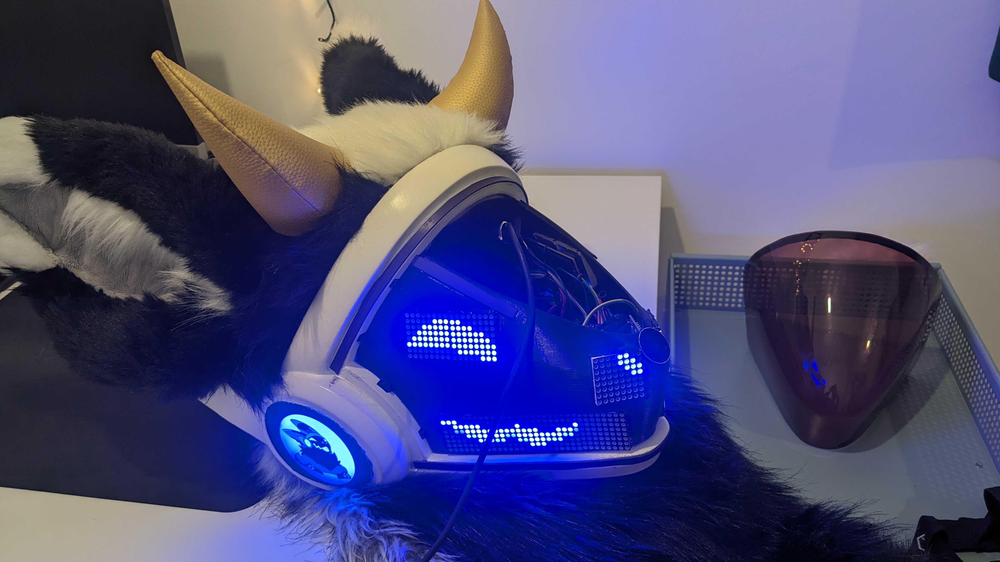

# Protosoft Toaster OS

Software to control protogen heads, using 8x8 MAX7219 LED matrices and an Arduino Nano Every or ESP32.

  

# Features

- Controls a protogen head using 8x8 LED matrices to render eyes, nose & mouth on each side of a face
- Supports light strips in each ear/headphones
- Nose "boop" detection & animation
- Blinking animations
- Different expressions, with simple animations
- Remote control support

  

# Guides
Step-by-step guides are on the [Toaster Oven website](https://toaster.badgercode.co.uk/guides).

**Setup**

1. [Setting up](https://toaster.badgercode.co.uk/guides/toaster-os/setting-up): wire up the LED panels, then configure Toaster OS and put it on your microcontroller
2. [Debugging](https://toaster.badgercode.co.uk/guides/toaster-os/debugging): fix scrambled, upside-down or glitching panels, and other common problems
3. [Managing expressions](https://toaster.badgercode.co.uk/guides/toaster-os/managing-expressions): draw, animate and organise your protogen's expressions

**Enabling features**

- [Side lights](https://toaster.badgercode.co.uk/guides/toaster-os/side-lights): RGB LED strips on the sides of the head
- [Boop sensor](https://toaster.badgercode.co.uk/guides/toaster-os/boop-sensor): detect nose boops, and react with different expressions
- [Remote control](https://toaster.badgercode.co.uk/guides/toaster-os/remote-control): change expressions and settings with a 4-button remote
- [Adding custom features](https://toaster.badgercode.co.uk/guides/toaster-os/adding-custom-features): write your own feature and hook it into Toaster OS

 

## Configuring

Use [Toaster Oven](https://toaster.badgercode.co.uk/configure) to configure your protogen in your browser: the panel layout, expressions and features. It makes the `Config.h` and `Protogen_Faces.h` files for you.

## Dependencies

- [FastLED](https://fastled.io/) (not included; installed via Arduino IDE)

   

# Electronics
Here are the electronics I used. See [Setting up](https://toaster.badgercode.co.uk/guides/toaster-os/setting-up#the-electronics) and the feature guides for how to wire them up.

- For both sides of the face
   - Mouth: 4 x MAX7219 8x8 LED matrices
   - Eyes: 2 x MAX7219 8x8 LED matrices
   - Nose: 1 x MAX7219 8x8 LED matrices
- For both sides of the head
   - A strip of 15 RGB LEDs (5V, 3-pin)
- Boop sensor
   - A 3-pin 5V IR obstacle detection sensor
- A 5V Noctua fan (40x40x10mm) for ventilation (not connected to the arduino)
- A USB cable and voltage + ground splitters to power everything via a USB battery pack

  

# Arduino Basics

- [Docs](https://docs.arduino.cc/learn/starting-guide/getting-started-arduino#a-typical-workflow)
- [Arduino IDE 2](https://docs.arduino.cc/software/ide-v2)
- [Example projects](https://github.com/BadgerCode/Arduino-Test-Projects)

## Nano Every Pin out

  

# Additional
For information on changing the config management website, see the [Toaster Oven README](./toaster-oven/README.md).

